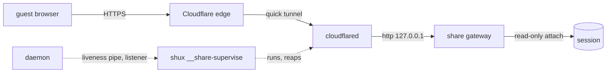

# Sharing a session

**TL;DR.** `shux share` gives you a private link to one session. Whoever opens
it watches that session live in a browser, read-only: they cannot type into
it, click in it, or resize it. The link works once, for an hour, unless you
say otherwise. Run `shux share stop` when you are done.

```bash
shux share -s work            # one link: one guest, one hour
shux share list               # what is live, and who is watching
shux share stop               # end every link and close the tunnel
```

It needs [cloudflared](https://developers.cloudflare.com/cloudflare-one/connections/connect-networks/downloads/)
(`brew install cloudflared` on macOS). No account, no port forwarding and no
SSH: the guest gets no shell, key or login on your machine.

## Usage

### Making a link

```bash
shux share                    # the session of the pane you are in, or the only one
shux share -s work            # a named session
shux share -s work --for 30m  # lasts 30 minutes (s, m, h, d; at most 24h)
shux share -s work --uses 3   # three guests may open it
shux share -s work --uses 0 --for 2h   # up to 32 guests; needs --for
shux share -s work --label "pairing w/ review"   # a note for `share list`
shux share -s work --qr       # also draw the link as a QR code (text output only)
shux share create -s work     # the same as bare `shux share`
```

The first link starts a public tunnel, which takes a few seconds. shux does not
hand you a link until it has checked that the tunnel reaches your daemon. The
link looks like `https://<words>.trycloudflare.com/v/<id>#<secret>`. For the
first minute a brand-new address may not resolve everywhere yet: if the guest
gets "can't find this site" or Cloudflare's error 1016, wait a moment and
reload.

**Send it privately**, in a direct message, not a channel, an issue, a pull
request or anywhere else people you did not mean can read it.

### Inside shux, the link is never printed

Any terminal inside a shux pane may be one someone is watching, so `shux share`
run there (wherever `SHUX_PANE_ID` is set) never prints the link:

- it copies the link to your clipboard (`pbcopy` on macOS; `wl-copy`, `xclip`
  or `xsel` on Linux) and prints a confirmation with the link's id, uses and
  expiry, never its address;
- with no clipboard, or with `--qr`, it refuses before making any link: run it
  from a terminal outside shux;
- if the copy fails or takes more than 10 seconds, or you press Ctrl-C during
  it, the link is revoked.

`--format json` follows the same rule: `url` is `null` and `deliver` is
`"clipboard"`. `shux rpc call share.create` from a pane is refused before
anything is minted. A link `shux share` minted but did not get to print or
copy (the CLI was killed, say) is revoked when its connection closes.
Outside shux the link is printed; anything printed there is not in a shux
session, so no guest can read it back.

### What a guest sees

The guest's first page says what this is before anything is spent: a live
terminal session they can watch and not type into, until when the link works
and how many uses it has left, and that you can see how many are watching. It
does not name the session. They click **Watch session**, and see the session's
panes as you do, at a size that fits their window, under a bar that reads
**◉ Read-only · demo · until 3:55 PM · 2 watching · live**. The count is the
one your badge shows, and nothing about who. A key press, a paste or a tap on
the terminal shows, once, "View only: your keys aren't sent." On a phone the
session opens at a readable size that pans with a swipe; the **Fit** button
shows the whole layout at once, and **Zoom** goes back.

Every new link also prints a reminder under it, and `--format json` carries it
as `notice`:

```text
Anyone with this link sees everything in demo, live, until 15:55. End it with: shux share stop
```

They do **not** see your status bar, other sessions, scrollback from before
they joined, or anything else on your machine. Nothing they do in the browser
reaches a pane: there is no path for a keystroke, a paste, a click or a
resize. Whatever the session shows on screen, they see, including secrets you
print there.

Reloading the page reconnects without spending another use. A second tab with
the same link takes over from the first.

### Watching who is watching

Your status bar shows the share in amber: `◉ shared · 0 watching` while a link
can still be opened, then the number of guests watching.

```bash
shux share list               # links, expiry, uses left, each viewer
shux share revoke <id>        # end one link and drop everyone it let in
shux share revoke all
shux share kick <viewer>      # drop one guest; the link stays
shux share stop               # end everything, close the tunnel
```

A guest is also listed by `shux client list`, marked `share`, and
`shux client detach <id>` drops it the same way `share kick` does: its
credential stops working and its page says it was removed. A guest's page
tells them why it ended: removed, revoked, expired, stopped, the session
ended, or the connection dropped.

When no guest can reach your daemon any more (the last link revoked, expired,
or used up with nobody still connected), shux closes the tunnel by itself. If
cloudflared dies, every link it carried ends; a new link gets a new address.

### Limits

| | |
|--|--|
| Lifetime | 1 hour by default, 24 hours at most |
| Guests per link | 1 by default; at most 32 (`--uses 0` means up to 32) |
| Watching at once, per link | 4 |
| Reconnects | 5 per guest in 10 seconds |
| A guest who leaves | can come back on the same link for 10 minutes |
| Per daemon | 64 live links, 16 streams |
| Wrong secrets | 10 a minute from one address, 300 a minute in all; past either, refused (429) for a while |

## Privacy, plainly

- **Cloudflare sees the stream.** The quick tunnel ends TLS at Cloudflare's
  edge, so Cloudflare can read what the guest sees and the link's secret as it
  passes.
- **The secret stays out of logs.** It travels after `#`, which browsers never
  send in a request. The browser trades it once for a cookie scoped to the
  link, then wipes it from the address bar.
- **Links are capabilities.** Whoever holds an unused link can use it. Keep
  uses low and durations short; revoke a link you sent to the wrong place.
- **Stop when you are done.** `shux share stop`.

## Internals

The daemon runs the share gateway on a loopback port that only the tunnel
reaches. Each guest's browser streams through a private read-only attach to
the session (#191's protocol v2), which holds no PTY writer and never sizes
the host; the stream is `shux.view.v1` into ghostty-web, embedded in the
binary.



- **Supervision.** The daemon execs `shux __share-supervise` with the liveness
  pipe on stdin and a duplicate of the gateway's listener on stderr. The
  supervisor runs cloudflared in its own process group, with neither, a
  private `HOME`, its own config and a bare environment, and reads its log,
  reporting only the origin and an exit code. It watches cloudflared's pid,
  not its log. When the pipe closes (stop, or the daemon dying, even by
  `SIGKILL`) or cloudflared exits, it kills the whole group, reaps it, and only
  then exits and releases the port.
- **The startup record.** The origin is read only from the line after
  cloudflared's "Your quick Tunnel has been created" header, and only as
  `https://<one label>.trycloudflare.com`. Overlong log lines are skipped
  without being held.
- **Proof before a link.** The daemon fetches a marker, fresh for this tunnel,
  from the exact public origin over HTTPS with no redirect, at the addresses
  `trycloudflare.com` resolves to. It waits up to 30 seconds for every one it
  can reach to answer, then settles for one.
- **Owner-local RPCs.** The `share.*` methods answer only on the daemon's own
  Unix socket: never over TCP, never to a plugin. Only `share.create` returns
  a URL, and it requires `from_pane`: `null` for a caller outside shux, any
  other value for clipboard-or-refuse.
- **Events.** Browser guests publish no `client.*` events; `share.created`,
  `share.ended` (`revoked`, `expired`, `stopped`, `session_ended`,
  `tunnel_lost`) and `share.tunnel` (`up`; `down` with `idle`, `stopped` or
  `lost`; `failed` with a reason) carry ids and reason codes only.
- **cloudflared.** `SHUX_CLOUDFLARED` (an absolute path) wins, then `PATH`,
  then `/opt/homebrew/bin`, `/usr/local/bin` and `/usr/bin`, as the daemon's
  environment has them.
